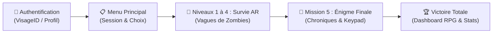

# 🧟‍♂️ QuestAR - Jeu Mobile en Réalité Augmentée (AR)

[](https://unity.com/)
[](https://developers.google.com/ar)
[](https://www.android.com/)
[](https://github.com/kaaboura12/QuestAr/tree/Negzaoui)

**QuestAR** est une expérience mobile immersive en **Réalité Augmentée (AR)** développée sur **Unity** pour les appareils Android supportant **ARCore**. Le projet fusionne le frisson de la survie en tir à la première personne (**FPS AR**) et la réflexion d'un **Escape Game en Réalité Augmentée**.

---

## 🎮 Déroulement du Jeu (Gameplay Flow)

Le joueur progresse à travers plusieurs étapes interactives :



1. **Authentification (`VisageID_Auth_Scene`)** :
   - Connexion via reconnaissance faciale ou profil joueur invité.
2. **Menu Principal (`MainMenu`)** :
   - Affichage de l'état du joueur, options audio et lancement des missions.
3. **Missions 1 à 4 : Survie & Combat AR (`ARGameplay`)** :
   - **Détection Stricte du Sol** : Détection des surfaces horizontales réelles (`ARPlaneManager`) pour un ancrage réaliste au sol (aucun zombie flottant ou collé aux murs).
   - **Système d'Armes & Visée** : Armes personnalisées avec visée précise (AIM), tir (FIRE) et gestion des munitions (RELOAD).
   - **Capteur de Luminosité Ambiante** : Mesure en temps réel des Lux de la pièce via `ARCameraManager` pour adapter l'ambiance et les mécaniques d'obscurité.
   - **Flash Tactique (Stun)** : Activation de la torche pour paralyser les créatures avec un temps de recharge stratégique (Cooldown de 10 secondes affiché sur le HUD).
   - **Microphone & Son** : Détection de l'intensité sonore pour réagir aux bruits ambiants.
4. **Mission 5 : L'Énigme Finale (`Mission5_Enigme`)** :
   - Exploration de l'environnement réel pour repérer les chroniques et reliques flottantes.
   - Vision vampirique et déchiffrage du lore ancien.
   - Pavé tactile (Keypad) optimisé en mode paysage pour saisir le code secret et briser le sceau.
5. **Écran de Victoire Totale** :
   - Célébration finale avec lauriers d'or, musique de triomphe, statistiques de la partie et boutons d'action (`REJOUER` / `DÉCONNEXION`).

---

## 🛠️ Architecture & Technologies

- **Moteur** : Unity 2022.3 (C#)
- **AR Framework** : Unity AR Foundation, ARCore XR Plugin (Tracking 6DoF, AR Raycast, Plane Tracking, Light Estimation)
- **Pipeline Graphique** : Built-in Render Pipeline (Shaders optimisés pour mobile)
- **Combat Rig** : Intégration Infima Games Low Poly Shooter Pack
- **Capteurs Matériels Exploités** :
  - Caméra AR & Gyroscope
  - Capteur de lumière ambiante (Lux continu)
  - Torche LED / Flash Android
  - Microphone
  - Moteur haptique (vibrations Android)

---

## 🚀 Installation & Build

### Prérequis :
- **Unity 2022.3 LTS** avec le module **Android Build Support** (OpenJDK, Android SDK & NDK).
- Un smartphone Android compatible **Google Play Services for AR (ARCore)**.

### Étapes :
1. Cloner le projet et basculer sur la branche :
   ```bash
   git clone https://github.com/kaaboura12/QuestAr.git
   cd QuestAr
   git checkout Negzaoui
   ```
2. Ouvrir le projet dans Unity Hub.
3. Aller dans **File > Build Settings...**, basculer la plateforme sur **Android**.
4. Vérifier l'ordre des scènes actives dans le build :
   - `0` : `Assets/VisageID_Auth/Scenes/VisageID_Auth_Scene.unity`
   - `1` : `Assets/_Project/Scenes/MainMenu.unity`
   - `2` : `Assets/_Project/Scenes/ARGameplay.unity`
   - `3` : `Assets/QuestAR/Scenes/Mission5_Enigme.unity`
5. Connecter le smartphone en mode Débogage USB et cliquer sur **Build and Run**.

---

## 📌 Spécificités de la Branche `Negzaoui`

Cette branche regroupe l'ensemble des développements et corrections majeurs :
- ✅ **Intégration complète de la scène `Mission5_Enigme`** et liaison automatique après la victoire du niveau 4.
- ✅ **Fix du Spawner AR** : Détection stricte des plans horizontaux inférieurs pour un spawn propre des zombies sur le sol réel.
- ✅ **Correction des Shaders** : Remplacement des shaders URP incompatibles (rose/magenta) par des shaders Standard optimisés.
- ✅ **Capteur de Lumière & Flash** : Activation continue du `requestedLightEstimation` et ajout d'un cooldown de 10 secondes sur le bouton Flash.
- ✅ **Keypad Landscape** : Repositionnement et adaptation tactile du pavé numérique pour écran horizontal.
- ✅ **Écran de Victoire Totale** : Interface de victoire finale avec reprise de session et retour au menu.

---

## 👤 Rôle & Réalisations de Negzaoui (Partie Negzaoui)

Dans le cadre du projet **QuestAR**, **Negzaoui** a assuré la réalisation de modules clés et le rôle central d'intégration :

### 1. 🔐 Système d'Authentification Complet (Login)
- **Développement intégral du module d'authentification** : Système de connexion sécurisée et gestion des comptes utilisateurs.
- **Intégration de VisageID** : Authentification biométrique par reconnaissance faciale sur mobile, complétée par un mode profil joueur / invité.
- **Gestion de Session Globale** : Création de la persistance des données du joueur (`ARPlayerSession`) transmises à travers toutes les scènes (affichage du nom du joueur sur le HUD de combat, conservation des scores et bouton de déconnexion dynamique).

### 2. 🔄 Intégration Globale Inter-Membres du Groupe
- **Fusion et synchronisation complète** des contributions de tous les membres de l'équipe au sein d'une architecture Unity unifiée, stable et sans conflit.
- **Orchestration du flux de jeu de bout en bout** :
  $$\text{Login VisageID} \longrightarrow \text{Menu Principal} \longrightarrow \text{Survie AR (Niveaux 1 à 4)} \longrightarrow \text{Énigme Finale} \longrightarrow \text{Victoire Totale}$$
- **Harmonisation technique** : Résolution des conflits de versions de scènes, standardisation des Build Settings Android et validation du pipeline d'exécution.

### 3. 🎯 Optimisations AR, Capteurs & Finitions
- **Correction critique du sol AR** : Calibrage précis de la détection de plan horizontal pour que les zombies apparaissent exclusivement sur le sol réel (suppression des zombies flottant dans les airs ou collés aux murs).
- **Exploitation avancée des capteurs** : Correction de l'estimation de la lumière en temps réel (Lux continu sur `ARCameraManager`) et implémentation du système de cooldown (10 secondes) pour la torche/flash avec feedback visuel.
- **Refonte UI de l'Énigme** : Adaptation du clavier tactile (Keypad) au format paysage (Landscape) et correction des shaders de matériaux roses incompatibles.
- **Écran de Victoire Totale** : Conception de l'interface de triomphe finale avec tableau de bord des statistiques RPG, effets sonores et navigation de fin de partie.

### 📂 Principaux Modules & Scripts pris en charge par Negzaoui :
| Module / Script | Rôle & Apport Technique |
| :--- | :--- |
| `VisageID_Auth` | Système complet de login, reconnaissance faciale et persistance de session joueur. |
| `QuestARLevelManager.cs` | Intégration globale, enchaînement des 4 niveaux de combat vers l'énigme et gestion de fin de partie. |
| `ARZombieSpawner.cs` | Algorithme de détection de sol réel (`Floor`) pour un spawn propre sans zombies flottants. |
| `HamaFlashStunManager.cs` | Gestion du capteur de luminosité (Lux) et système de Cooldown (10s) pour la torche. |
| `ARPlayerSessionHud.cs` & `MainMenuController.cs` | Synchronisation de l'identité du joueur entre le menu, le HUD et la déconnexion. |
| `CodePuzzle.cs` & `IndicesFlottants.cs` | Adaptation ergonomique du clavier en mode paysage et synchronisation des chroniques. |
| `Mission5_Enigme.unity` | Intégration et raccordement de la scène d'énigme finale à l'architecture globale. |


